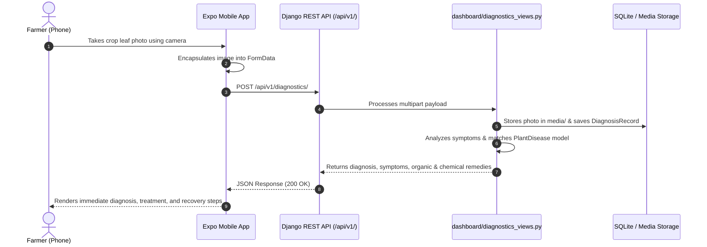

# SmartKrushi — Architecture & System Design

## 1. High-Level Architectural Diagram

```
+---------------------------------------------------------------------------------+
|                                 CLIENT LAYER                                    |
|                                                                                 |
|   +------------------------------------+   +--------------------------------+   |
|   |   React Native (Expo Mobile App)   |   |  Companion React Web App       |   |
|   |   - Expo Router (src/app/)         |   |  - Vite + React 19             |   |
|   |   - Android / iOS / APK            |   |  - Tailwind CSS + i18n         |   |
|   +-----------------+------------------+   +---------------+----------------+   |
+---------------------|--------------------------------------|--------------------+
                      | HTTP REST API (/api/v1/)             |
                      +------------------+-------------------+
                                         |
+----------------------------------------v----------------------------------------+
|                                BACKEND LAYER                                    |
|   Django REST Framework 3.18.1 / Django 6.1.1 (WSGI/ASGI on Port 8000)          |
|                                                                                 |
|   +--------------------+  +--------------------+  +--------------------+        |
|   |    CORS Headers    |  |  JWT / Session Auth|  | drf-spectacular     |        |
|   |  (Mobile & Web)    |  | (rest_framework)   |  | (Swagger / OpenAPI)|        |
|   +--------------------+  +--------------------+  +--------------------+        |
|                                                                                 |
|   CORE DJANGO APPS:                                                             |
|   [weather]         [crops]           [soil]            [plant_health]          |
|   [dashboard]       [accounts]        [recommendations] [fertilizers]           |
|   [locations]       [datasets]        [chatbot]         [predictions]           |
+----------------------------------------+----------------------------------------+
                                         |
           +-----------------------------+-----------------------------+
           |                                                           |
+----------v-----------------------------+   +-------------------------v----------+
|             PERSISTENCE LAYER          |   |          EXTERNAL INTEGRATIONS     |
|                                        |   |                                    |
|   - SQLite 3 (db.sqlite3)              |   |   - OpenWeather Site API           |
|   - MySQL Database (Production Ready)  |   |   - Open-Meteo Weather API         |
|   - Media Storage (Crop Photos)        |   |   - Expo Cloud EAS Build System    |
+----------------------------------------+   +------------------------------------+
```

---

## 2. Component Breakdown

### 2.1 Frontend Client (Mobile App)
- **Framework**: React Native with Expo SDK 57.
- **Routing Engine**: Expo Router. Provides native stack navigation (`src/app/_layout.js`) and bottom tab bar navigation (`src/app/(tabs)/_layout.js`).
- **Data Fetching Layer**: `src/lib/api.js` provides centralized, network-aware HTTP utilities:
  - `getJson(path, params)`: Executes asynchronous requests to the Django REST endpoints.
  - `postForm(path, fields)`: Handles `multipart/form-data` payloads for crop diagnostic leaf images.
- **Network Resolution**:
  - Dynamically switches between `http://10.0.2.2:8000/api/v1` (Android Emulator loopback) and `http://<LAN_IP>:8000/api/v1` (physical phone via Wi-Fi).

### 2.2 Backend Application Server (Django)
- **Framework**: Django REST Framework.
- **Settings Module**: `config/settings.py` sets middleware ordering:
  1. `corsheaders.middleware.CorsMiddleware` (MUST precede all other middleware).
  2. `SecurityMiddleware`, `SessionMiddleware`, `CommonMiddleware`, `AuthenticationMiddleware`.
- **Authentication**: Dual support for SimpleJWT tokens (`Bearer <token>`) and session-based authentication for administrative tooling.
- **App Modularity**: Each business domain is encapsulated in an isolated Django application with dedicated models, serializers, views, and URL routers.

### 2.3 External Telemetry & APIs
- **OpenWeather Site API**:
  - Endpoint: `https://api.openweathermap.org/data/2.5/weather`
  - Integrated via `weather.services.WeatherService`.
- **Open-Meteo Weather Fallback**:
  - Endpoint: `https://api.open-meteo.com/v1/forecast`
  - Zero-credential public fallback to ensure high availability.

---

## 3. Data Flow Example: Plant Disease Diagnosis


