# SmartKrushi — Complete Technical Documentation
## AI-Powered Smart Agriculture Assistant Platform

> **Project**: SmartKrushi  
> **Stack**: Django REST Framework (Backend) + React Native / Expo (Mobile Frontend)  
> **Database**: SQLite3 (Dev) / MySQL (Production)  
> **Version**: 1.0  
> **Date**: October 2026

---

## Table of Contents

| No. | Diagram | Category |
|-----|---------|----------|
| 1 | [System Architecture Diagram](#1-system-architecture-diagram) | System Design |
| 2 | [System Context Diagram](#2-system-context-diagram) | Architecture |
| 3 | [Use Case Diagram](#3-use-case-diagram) | UML |
| 4 | [Activity Diagram](#4-activity-diagram) | UML |
| 5 | [Class Diagram](#5-class-diagram) | UML |
| 6 | [Sequence Diagram](#6-sequence-diagram) | UML |
| 7 | [Component Diagram](#7-component-diagram) | UML |
| 8 | [Deployment Diagram](#8-deployment-diagram) | UML |
| 9 | [ER Diagram](#9-er-diagram) | Database |
| 10 | [DFD Level 0](#10-dfd-level-0) | Data Flow |
| 11 | [DFD Level 1](#11-dfd-level-1) | Data Flow |
| 12 | [Crop Recommendation Workflow](#12-crop-recommendation-workflow) | Process Design |
| 13 | [Plant Disease Diagnosis Workflow](#13-plant-disease-diagnosis-workflow) | Process Design |
| 14 | [Weather API Integration Diagram](#14-weather-api-integration-diagram) | API Integration |
| 15 | [Research Methodology Flowchart](#15-research-methodology-flowchart) | Research Work |

---

## 1. System Architecture Diagram

**Category**: System Design  
**Description**: Shows the overall multi-tier architecture of SmartKrushi — from the client layer to the backend, persistence, and external APIs.

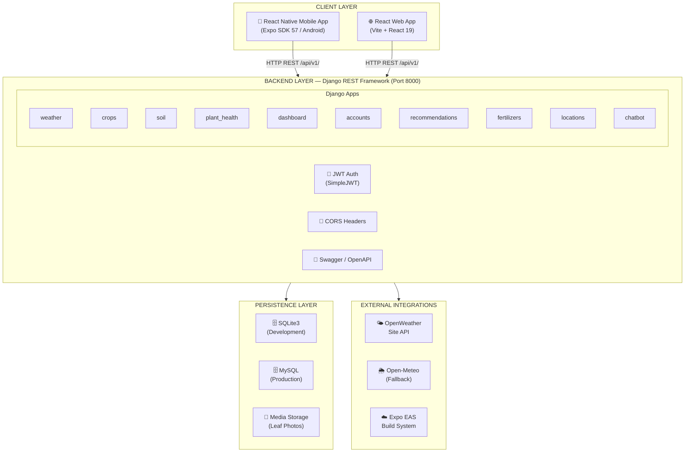

---

## 2. System Context Diagram

**Category**: Architecture  
**Description**: High-level view showing SmartKrushi as a black box and all external actors that interact with it.

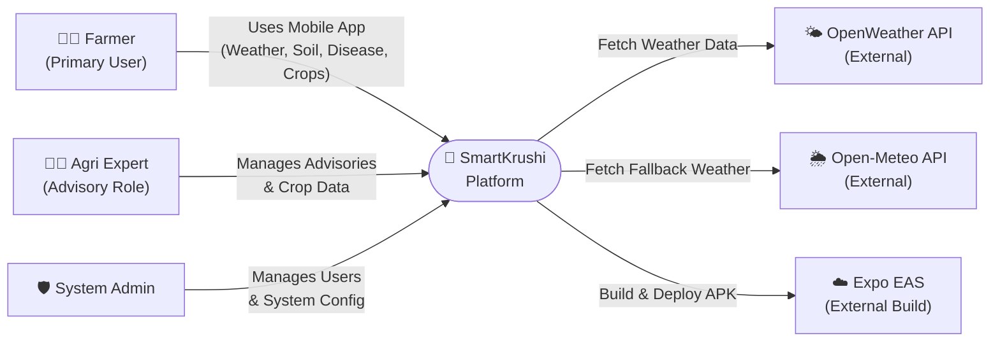

---

## 3. Use Case Diagram

**Category**: UML  
**Description**: All use cases available to the three primary actors — Farmer, Agri Expert, and Admin.

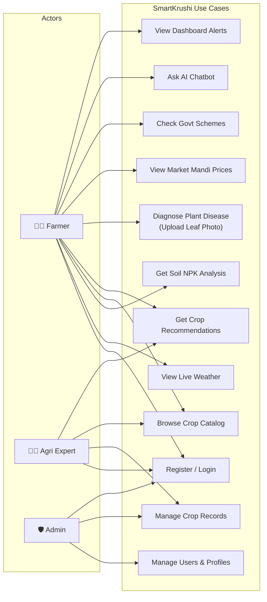

---

## 4. Activity Diagram

**Category**: UML  
**Description**: Step-by-step activity flow for the core farmer journey — from login to getting a crop recommendation.

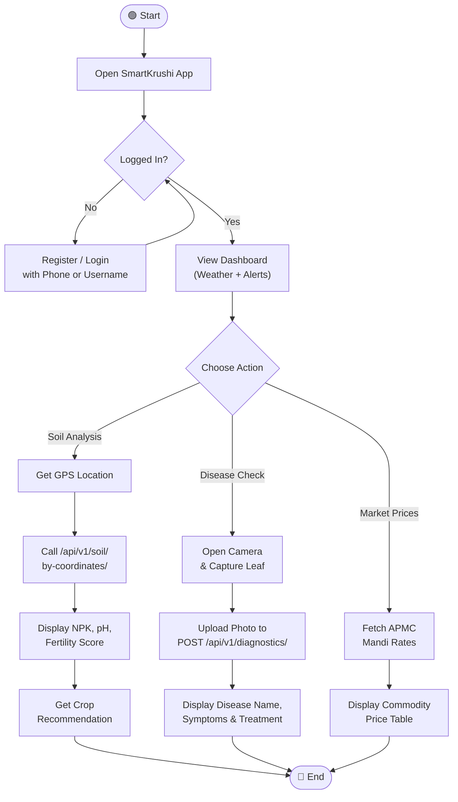

---

## 5. Class Diagram

**Category**: UML  
**Description**: Key Django model classes and their relationships across the SmartKrushi backend.

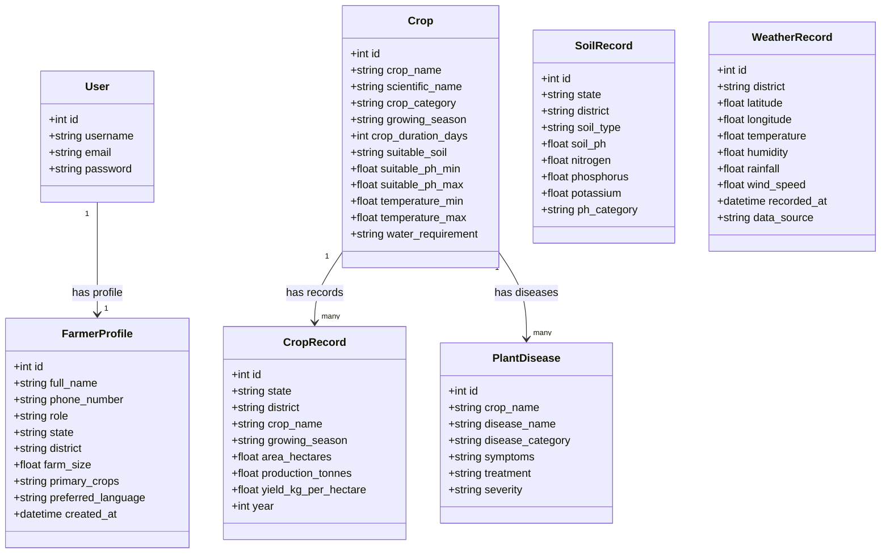

---

## 6. Sequence Diagram

**Category**: UML  
**Description**: Detailed interaction sequence for Plant Disease Diagnosis — from farmer camera click to diagnosis result.

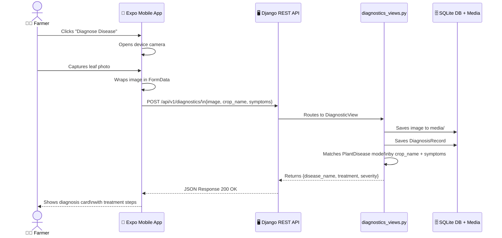

---

## 7. Component Diagram

**Category**: UML  
**Description**: Major software components of SmartKrushi and how they interface with each other.

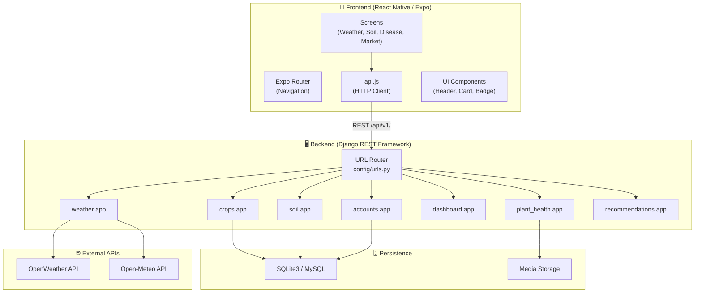

---

## 8. Deployment Diagram

**Category**: UML  
**Description**: Physical deployment of SmartKrushi across developer machine, Android device, and cloud.

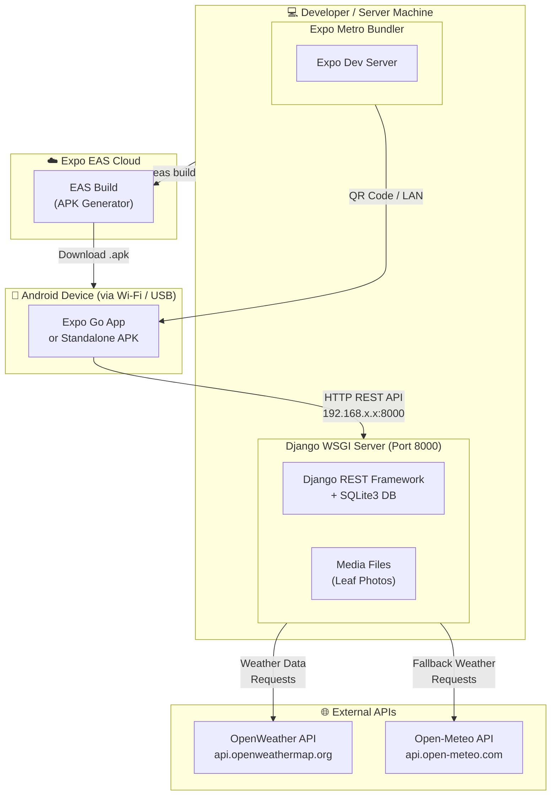

---

## 9. ER Diagram

**Category**: Database  
**Description**: Entity-Relationship diagram showing all major database tables and their relationships.

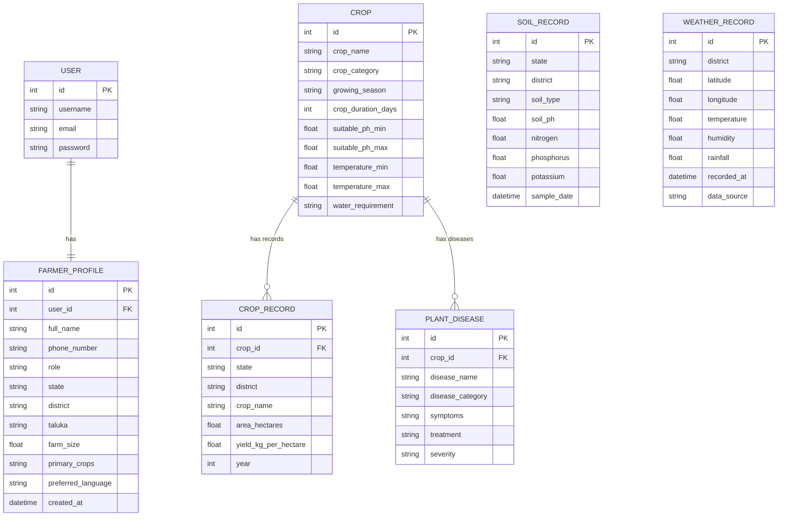

---

## 10. DFD Level 0

**Category**: Data Flow  
**Description**: Top-level data flow — SmartKrushi system as a single process with all external entities.

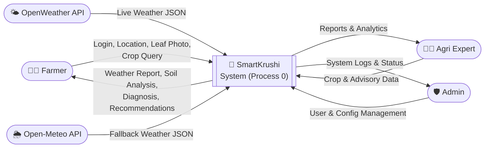

---

## 11. DFD Level 1

**Category**: Data Flow  
**Description**: Decomposed data flow showing all major sub-processes within SmartKrushi.

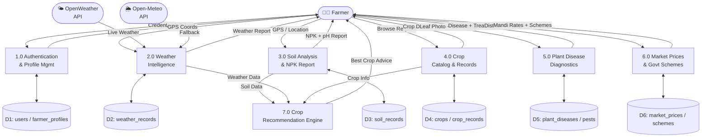

---

## 12. Crop Recommendation Workflow

**Category**: Process Design  
**Description**: End-to-end workflow showing how SmartKrushi generates a crop recommendation based on soil, weather, and farmer input.

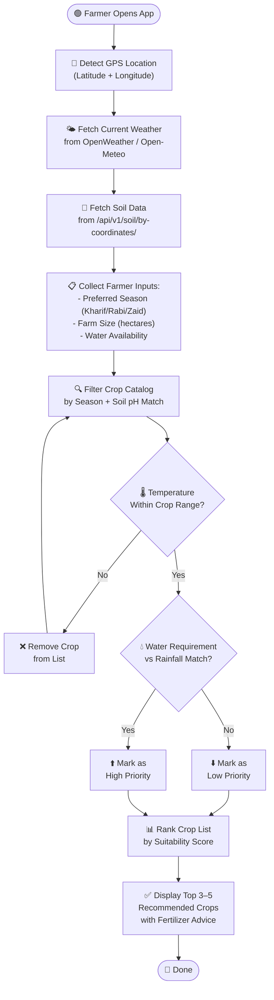

---

## 13. Plant Disease Diagnosis Workflow

**Category**: Process Design  
**Description**: Complete step-by-step workflow for plant disease diagnosis via camera image upload.

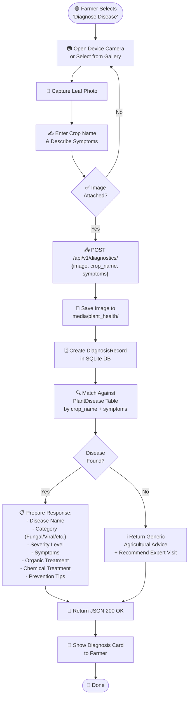

---

## 14. Weather API Integration Diagram

**Category**: API Integration  
**Description**: Shows how SmartKrushi fetches weather data from two sources with fallback logic.

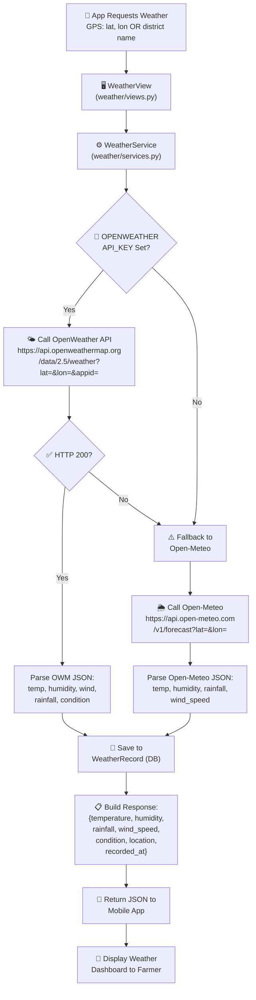

---

## 15. Research Methodology Flowchart

**Category**: Research Work  
**Description**: Research methodology followed in the design, development, and validation of the SmartKrushi platform.

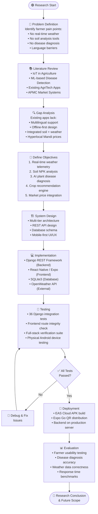

---

## Summary

| Module | Technology | Purpose |
|--------|-----------|---------|
| **Mobile App** | React Native + Expo | Farmer-facing interface |
| **Web App** | Vite + React 19 | Desktop companion portal |
| **Backend API** | Django 6.1 + DRF 3.18 | REST API & business logic |
| **Database** | SQLite3 / MySQL | Data persistence |
| **Weather** | OpenWeather + Open-Meteo | Live weather telemetry |
| **Auth** | SimpleJWT | Secure token authentication |
| **Build** | Expo EAS | Android APK cloud build |
| **Docs** | Swagger / OpenAPI | Interactive API explorer |

---

*SmartKrushi — Empowering Indian Farmers with AI-Powered Agricultural Intelligence.*
